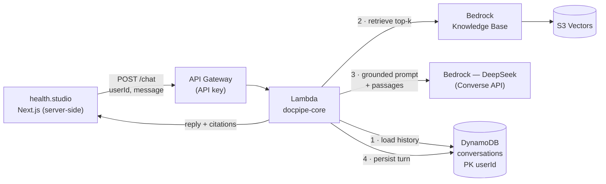
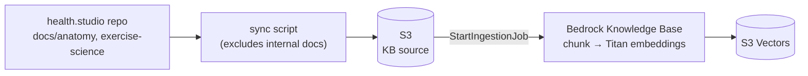
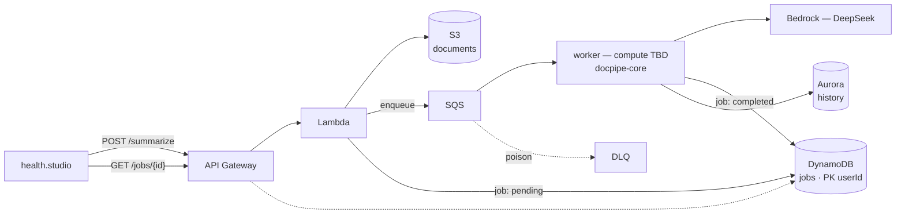

# docpipe — health.studio AI services on AWS

[](https://aws.amazon.com/bedrock/)
[](https://www.pulumi.com/)
[](https://www.python.org/)
[](https://github.com/astral-sh/uv)


> **Public showcase.** Readable end to end on purpose — the Pulumi components,
> the ingestion pipeline and the retrieval path are all here. No license is
> attached, so it's *read, don't lift*: all rights reserved.

The AWS-hosted AI backend for [health.studio](https://health.studio): a chat
assistant and an async document-summarization pipeline, called server-side by
the health.studio Next.js app (which runs on its own infra). Built on:

**Bedrock (DeepSeek) · Lambda · DynamoDB · API Gateway · S3 · RDS (Aurora) · VPC · IAM · CloudWatch · SQS — provisioned with Pulumi (Python).**

## How it works

Three cycles. The **chat path** and the **summary path** share one Python
package (`docpipe-core`); the **knowledge-base ingestion** runs offline and
feeds the chat path.

### 1. Chat — synchronous, grounded in the knowledge base

A user question is answered from health.studio's evidence-graded corpus, with
citations. Latency-sensitive, so it's Lambda with no queue.



The passages carry their source URIs and evidence ratings; the system prompt
tells DeepSeek to cite what it used and to say so when the KB doesn't cover the
question, instead of guessing.

### 2. Knowledge-base ingestion — offline, runs when the docs change

health.studio's public anatomy / exercise-science docs become searchable
vectors. Not in any request path — runs on demand (or in CI).



Vectors live in **S3 Vectors** (not OpenSearch Serverless) — serverless and
near-zero cost at rest, which keeps the whole chat path permanently
deployable.

A **second** Knowledge Base sits over the same source bucket, backed by
**Aurora PostgreSQL + pgvector** — built and ingested 2026-08-20, both KBs
holding the same 496-chunk corpus and differing only in the storage slot. The
two are the subject of the benchmark that is this project's headline
deliverable (`PLAN.md`, Phase 5b).

Its first result: **the store barely matters.** Recall is identical (0.7879),
MRR within noise (0.5634 S3 Vectors / 0.5646 Aurora), and agentic retrieval
lands 0.89–0.95 on either store in any search mode — the retrieval *loop* is
the effect, not the store. Aurora's clear wins are warm latency (~2×: p50
0.523 s vs 0.960 s) and the exhibits only a real database can produce.

### 3. Summaries — asynchronous, decoupled by a queue

Training logs / session notes are summarized off the request path, because LLM
calls are slow and must not block the caller.



The compute split is deliberate: **Lambda** for the spiky request edge, and a
separate long-running consumer for the queue. **Which compute backs that
consumer is still open** — Lambda, Fargate or EKS, with Lambda the current
recommendation on cost (see [`PLAN.md`](PLAN.md) Phase 5); the diagram shows the
role, not a decision. Everything is per-user (opaque IDs from the app; no
PII/PHI crosses to AWS), and the chat path can stay up permanently while the
worker + Aurora side is torn down between sessions.

## The benchmark: S3 Vectors vs Aurora pgvector, same corpus, same questions

Two Bedrock Knowledge Bases over one S3 source bucket, differing in exactly
one slot — the vector store. Same 585-chunk corpus, same Titan v2 @ 1024
embeddings, one ratified 66-question answer key (61 answerable + 5 the corpus
deliberately cannot answer). Every retrieval strategy is a row; every number
has a signed report in [`docs/baselines/`](docs/baselines/) and a dated entry
in [`FINDINGS.md`](FINDINGS.md).

Recall below is **on the 61 answerable questions**. Single-shot rows score the
one returned list (recall@5); agentic rows score the whole session (any tool
call's top-5 — a different instrument, so don't read across the gap as if it
were one column).

| strategy | S3 Vectors | Aurora | per 1k questions |
|---|---|---|---|
| single-shot, semantic, k=5 | 0.7869 | 0.8033 | $0.06 / ~$0.01 warm |
| single-shot + Cohere rerank (25-doc pool) | **0.8525** | **0.8525** — identical, question by question | + $2.00 |
| agentic loop (DeepSeek drives `search_kb`), guarded | 0.8033 | 0.8033 (mean of 2 ea.) | ~$4.60 |
| agentic loop, unguarded | 0.9057 (mean of 4, both stores) | ← | ~$5.70 |
| agentic + verbatim-first seed | **0.9467** (3 of 4 runs = 58/61) | ← | ~$5.70 |

**What the table actually says:**

1. **The store is not the lever.** Reranked, the two stores return the same
   top-5 question by question (66/66 same hit, 66/66 same rank) — the
   cross-encoder demotes both to candidate generators for the same pool. On
   the agentic path the loop, not the store, buys the recall. The real levers
   all live *above* the store.
2. **The guardrail gives back everything the loop buys.** Guarded agentic
   recall (0.8033) lands exactly on single-shot. It intervenes on 20–23 of 66
   questions per run, stochastically (31-question pool, none blocked every
   run), concentrated on the clinical strata — 4/4 nerve, 3/3 referral, 2/2
   entrapment questions ever-blocked. Tuning it is on the critical path.
3. **Seeding tool call 1 with the user's verbatim question** (instead of
   letting the model reformulate from scratch) is worth +4 points and
   collapses run variance — at the cost of zeroing abstention on the
   questions the corpus can't answer, because the seed retrieves before the
   model can decline.

**Where each store wins:**

| | S3 Vectors | Aurora pgvector |
|---|---|---|
| warm Retrieve p50 / p95 | 0.960 s / 1.797 s | **0.523 s / 0.873 s** (~2×) |
| at rest | **$0.00** | ~$0.12/mo floor (storage + backup survive auto-pause) |
| cold start | none | resume ~15 s; first call after idle measured at 23.5 s; ~$0.005 per cold visit |
| per query | flat $0.000056, any traffic pattern | ~$0.000009 warm — steady traffic wins, sparse traffic pays the wake |
| HYBRID search | rejected outright | supported (and net-negative on this corpus: 0.5331 MRR vs 0.5646 semantic) |
| introspection | opaque | full SQL: the `ef_search` sweep, near-dup scan, `EXPLAIN` |

The introspection row is where Aurora earned its keep this phase, in both
directions: the `hnsw.ef_search` sweep came back **flat** (identical recall
and per-question ranks at ef 10–200 — 585 vectors is too small for HNSW to
approximate, and only direct SQL could prove that), and the same instrument
showed **~70% of the shipped path's warm latency is Bedrock overhead, not the
database** (0.154 s direct SQL vs 0.523 s via Retrieve). The near-dup scan
answered "are my chunks distinct": prose entirely yes, while the anatomical
nerve registry carries ~93 sibling pairs the embedder can barely separate —
measured confusability exactly where retrieval misses live.

**The verdict:** on the shipped path, Aurora vs S3 Vectors is not a
retrieval-quality decision and not a meaningful cost decision (the store is
1–3% of marginal cost; the LLM loop is ~100× the retrieval it drives). It is
an operational-shape decision — latency floor and SQL introspection vs zero
standing cost and no wake — and this repo keeps both because the benchmark
*was* the deliverable.

## Health & privacy constraints

- The assistant is **non-diagnostic**: system prompt forbids diagnosis and
  prescriptions, and directs red-flag symptoms to a clinician (mirrors the
  red-flag gate already in the health.studio app).
- **Grounded, not vibes**: answers are anchored to the same evidence-graded,
  publicly-sourced knowledge base the app publishes — with citations — and
  the assistant admits when the KB doesn't cover a topic.
- **No PII/PHI leaves health.studio**: the app sends anonymous conversation
  content keyed by opaque user/conversation IDs — no names, emails, or
  account data. The KB contains only public content.
- All calls are server-to-server; the browser never talks to this API.

## Repo layout

Every top-level directory is named for the **role** it plays, never for the
tool that happens to implement it — and the runnable half is split by *who
runs it*, which is the load-bearing rule:

```
packages/core/     the library: models, storage, queue, Bedrock
                   chat/summarization/agent clients, retrieval, eval scoring,
                   corpus sync. Installed, typed, unit-tested; src layout so
                   tests can only import the installed package. All logic
                   lives here — nothing below is allowed to get clever.
services/          the deployables: each dir ships as a unit. kb_sync (corpus
                   sync CLI) today; api (Lambda) lands in Phase 3, worker
                   (SQS consumer) in Phase 5. Thin shells over core.
scripts/           operator CLIs — run from a laptop, never deployed:
                   kb_eval, kb_agentic_eval, aurora_bootstrap, status,
                   playground (`make playground` — chat in a browser),
                   graph_index (`make graph-index` — the body-graph edges).
                   Also thin shells over core; if a script grows logic,
                   the logic moves into core with tests (see agent.py).
infra/             infrastructure as code, quarantined: one component per
                   concern, own CI job, no imports in either direction
                   between it and the Python packages.
docs/              runbooks, committed baselines/reports, decision records.
```

If you know TS monorepos, the shape is familiar — `packages/` is `packages/`,
`services/` is `apps/`, `scripts/` is `tools/`, `infra/` is `infra/`. Two of
those names are deliberately *not* borrowed. Python has no convention above the
package level (the one real rule, PyPA's `src/` layout, is already followed
inside `packages/core/`), so the names answer to Python readers instead:
`apps/` is Django's word for pluggable libraries — the opposite of a deployable
— and these are backend units anyway, a Lambda and a queue consumer.
`scripts/` is plain idiomatic Python.

The rule that keeps this from rotting: **`services/` and `scripts/` are thin
shells.** The moment one grows logic, that logic moves into `packages/core`
with tests — which is exactly what happened to the agent tool loop in
`c74898f`.

## Infra / secrets split

Everything in this repo is public by design. What never enters git:

- Pulumi state — lives in a self-managed S3 backend (`pulumi login s3://…`)
- credentials — AWS auth via profile/SSO/environment, never in code

See [`infra/README.md`](infra/README.md) for the component map and
[`PLAN.md`](PLAN.md) for the build phases and current status.

## Dev quickstart

```bash
uv sync --all-packages         # install workspace incl. dev deps (Python 3.12)
uv run pytest                  # shared package tests
make fmt lint typecheck        # ruff + mypy
make status                    # live stack snapshot → dashboard.html
```

### `make status`

Probes the deployed stack and writes `status.json` + a self-contained
`dashboard.html`: resource inventory (Pulumi state), per-service health and
metrics (DynamoDB, S3, SQS, KB, guardrail, VPC), Bedrock model availability,
month-to-date cost (Cost Explorer), and build progress parsed from `PLAN.md`.
Every probe is independent — a missing permission degrades one card instead of
failing the run. Both files are gitignored; regenerate rather than commit.

## Cost notes

The foundation is designed to cost **~$0 at rest** — and *at rest* is doing
real work in that sentence. **Aurora has been on since 2026-08-20**
(`enableAurora: "true"`), so the floor is no longer $0: `min_capacity = 0`
pauses **ACU billing** but not storage or backup, putting it at **~$0.12/mo**.
Small, but not zero — quoted honestly because the whole point of Phase 5b is a
cost column nobody has to trust. (Month-to-date across every service still
rounds to $0, but the cluster has only existed for two days and Cost Explorer
lags, so the design figure is the one to plan against, not that reading.)

There is deliberately **no NAT gateway** — nothing needs VPC egress (the chat
Lambda runs outside the VPC; the KB is serverless S3 Vectors; Aurora uses the
RDS Data API). The VPC, subnets, gateway endpoints, DynamoDB (on-demand), SQS,
S3, and S3 Vectors are all free or pay-per-use at rest.

The only standing cost today is Aurora's ~$0.12/mo of storage and backup —
everything else is free or pay-per-use at rest. The sync chat path (API Gateway
+ Lambda + Bedrock + DynamoDB + KB) can stay up permanently; `make infra-down`
tears down everything when idle. Worker compute (Phase 5) is still an open
decision — EKS would be the one always-on cost (~$73/mo), which is why Lambda
is the default recommendation.

**The four classic budget sinks in this stack — and how we avoid them:**

| Sink | If you're careless | Our design |
|------|-------------|------------|
| NAT gateway | ~$32/mo idle | **Removed** — no VPC egress needed |
| OpenSearch Serverless (vector store) | ~$345/mo floor | **S3 Vectors** instead |
| EKS control plane | ~$73/mo always-on | Phase 5 only; tear down when idle (reconsider vs Lambda/Fargate) |
| Aurora warm cluster | ~$43/mo+ | `min_capacity = 0` → **auto-pauses**, idle ≈ $0; ~$0.12/ACU-hr only while serving; gated off by default |

### Deliberate trade-offs (not just "picked the cheap option")

- **Aurora `min_capacity = 0` costs a cold first query.** When the cluster has
  auto-paused, the first connection pays a resume latency before it serves.
  We accept that because the summary worker is async — a few seconds on the
  first job after idle is invisible to users. *Measured: the first call after
  idle took **23.5 s** (vs 1.32 s warm, 2026-08-23); the Data API surfaces the
  resume as a retryable `DatabaseResumingException` for ~15 s of that.*
- **Titan v2 embeddings pinned to 1024 dims** (`dimensions = 1024`), matching
  the S3 Vectors index. Chosen once, up front — the index can't mix dimensions.
